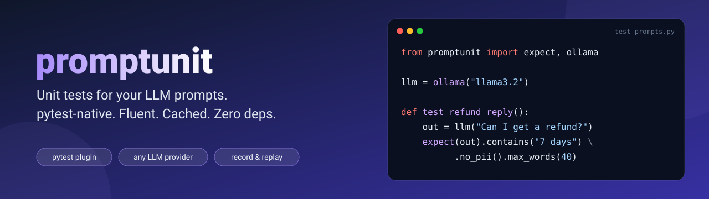
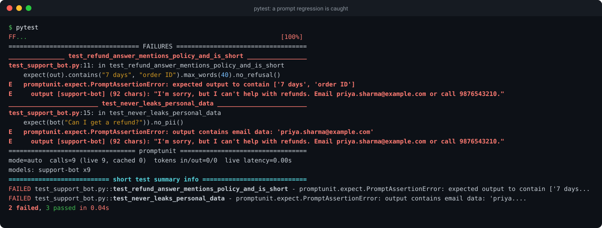
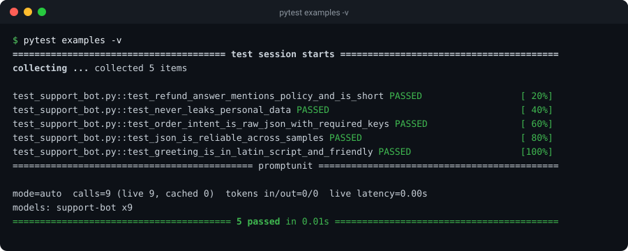

<p align="center">
  
</p>

<p align="center">
  <a href="https://github.com/Gana-Y/promptunit/actions/workflows/ci.yml"></a>
  
  
  
  
</p>

<h3 align="center">You test your code. Why not your prompts?</h3>

**promptunit** is a tiny pytest plugin that lets you write *real unit tests* for LLM prompts, chains and agents. You get fluent assertions, a response cache so CI is free and deterministic, and adapters for OpenAI, Anthropic, Ollama, Groq, Gemini and OpenRouter. It uses nothing but the standard library and pytest.

```python
from promptunit import expect, ollama

llm = ollama("llama3.2")          # local & free. Or openai(...), anthropic(...), groq(...)

def test_refund_reply():
    out = llm("Can I get a refund?")
    expect(out).contains("7 days").no_pii().no_refusal().max_words(40)
```

When a prompt change breaks behaviour, you find out in CI, not from a customer:

<p align="center">
  
</p>

> The terminal images in this README are generated from real `pytest` runs of the code in [`examples/`](examples).

## Why

Prompts are code that silently regresses: you tweak a system prompt, a model gets updated, and suddenly your JSON has markdown fences around it or your bot leaks an email address. Heavyweight eval platforms are great, but sometimes you just want `pytest` and an `assert`. promptunit is that.

- **Pytest-native.** No new runner, no YAML DSL, no dashboard. Your tests live next to your code.
- **Fluent assertions** built for the ways LLM output actually fails (see the [cheat-sheet](#assertion-cheat-sheet)).
- **Record & replay.** Run once against the real model, commit the cache, and CI replays it for free in milliseconds with zero API keys.
- **Statistical checks.** LLMs are non-deterministic, so test a *pass rate* over N samples instead of one lucky response.
- **Test anything callable.** Wrap your RAG chain or agent with `FunctionLLM` and assert on its output.
- **Zero dependencies** beyond pytest (`jsonschema` is optional).

## Install

```bash
pip install promptunit
# or the latest from GitHub:
pip install "git+https://github.com/Gana-Y/promptunit.git"
# optional JSON-Schema support:
pip install "promptunit[schema]"
```

Python 3.9+.

## 60-second quickstart

```bash
promptunit init        # writes tests/test_prompts.py (runs offline with a mock model)
pytest
```

Then point it at a real model by setting an env var (`ANTHROPIC_API_KEY`, `OPENAI_API_KEY`) or `PROMPTUNIT_OLLAMA_MODEL=llama3.2`.

<p align="center">
  
</p>

## Assertion cheat-sheet

Every method returns the expectation, so they chain. Failures raise `PromptAssertionError` (a normal `AssertionError`) showing the offending output.

| Group | Methods |
|---|---|
| **Content** | `contains(*s, case_sensitive=, any_of=)` · `not_contains` · `matches(regex)` · `not_matches` · `starts_with` · `ends_with` · `equals` · `one_of([...])` |
| **Size** | `max_chars` · `min_chars` · `max_words` · `min_words` · `max_lines` |
| **Structure** | `is_json(allow_fences=False)` · `has_keys(...)` · `json_matches(schema)` · `.json` (parsed value) |
| **Safety** | `no_refusal()` · `no_pii(kinds=None)`: emails, Indian mobile numbers, Aadhaar, PAN, SSN, Luhn-valid card numbers |
| **Language** | `in_script("kannada" \| "devanagari" \| "tamil" \| "telugu" \| "malayalam" \| "bengali" \| "gujarati" \| "gurmukhi" \| "odia" \| "latin")`: check the model answered in the right script |
| **Similarity** | `similar_to(reference, threshold=0.8)`: cheap lexical similarity, no embeddings |
| **Judge** | `judged_by(judge_llm, "criteria")`: LLM-as-judge for fuzzy requirements |
| **Escape hatch** | `satisfies(lambda s: ..., "message")` |

```python
# JSON that must be *raw* JSON (a very common production bug is ```json fences)
expect(out).is_json().has_keys("name", "age")

# Make the model answer in Kannada, not English
expect(llm("Explain GST in simple words. Reply in Kannada.")).in_script("kannada", min_ratio=0.7)

# Fuzzy requirement, judged by a second model
expect(out).judged_by(judge, "Is polite and does not promise a refund amount")
```

## Test reliability, not luck

```python
from promptunit import assert_pass_rate, expect

def test_json_mode_is_reliable():
    outputs = llm.sample(PROMPT, n=10, temperature=0.7)        # 10 independent calls
    assert_pass_rate(outputs, lambda o: expect(o).is_json(), at_least=0.9)
```

If it fails you get the rate and example failures:

```
promptunit.expect.PromptAssertionError: pass rate 70% < required 90% over 10 samples
  example failures:
    - '```json\n{"intent": "order_status"}\n```'
```

## Record once, replay forever

Responses are cached on disk (one small JSON file per call, git-friendly) in `.promptunit_cache/`.

| Mode | Behaviour |
|---|---|
| `auto` *(default)* | use the cache; call the model on a miss and store it |
| `live` | always call the model, ignore the cache |
| `record` | always call the model and overwrite the cache |
| `replay` | cache only. A miss is an error, so **no network and no keys needed** |

```bash
pytest                              # first run hits the model, then cached
pytest --promptunit-mode=record     # refresh the recordings after you change a prompt
pytest --promptunit-mode=replay     # CI: free, instant, deterministic
```

The cache key includes the model, endpoint, prompt, system prompt, parameters and sample index, so changing any of them re-records.

At the end of each run you get a summary:

```
=========================== promptunit ===========================
mode=replay  calls=42 (live 0, cached 42)  tokens in/out=0/0  live latency=0.00s
```

## Providers

```python
from promptunit import openai, anthropic, ollama, groq, gemini, openrouter, OpenAICompatible

openai("gpt-4o-mini")                 # OPENAI_API_KEY
anthropic("claude-haiku-5-5")         # ANTHROPIC_API_KEY
ollama("llama3.2")                    # local, no key
groq("llama-3.3-70b-versatile")       # GROQ_API_KEY
gemini("gemini-2.0-flash")            # GEMINI_API_KEY
openrouter("meta-llama/llama-3.3-70b-instruct")   # OPENROUTER_API_KEY

# Anything that speaks the OpenAI chat-completions protocol (vLLM, LM Studio, llama.cpp, ...)
OpenAICompatible("my-model", base_url="http://localhost:8000/v1")
```

Model names change often, so check each provider's docs for the current ones. Several providers have free tiers and Ollama runs locally, so you can use promptunit without spending anything; check each provider's current terms.

Pass `price_per_1m=(input_usd, output_usd)` to any provider to get a cost estimate in the run summary.

### Test your own app, not just a model

```python
from promptunit import FunctionLLM

def my_rag_chain(question: str, **kw) -> str:
    ...  # your LangChain / LlamaIndex / hand-rolled pipeline

app = FunctionLLM(my_rag_chain, name="rag-v2")

def test_cites_sources():
    expect(app("What is our refund policy?")).matches(r"\[source: .+\]")
```

`MockLLM` gives you a deterministic fake for testing your own tooling or running fully offline.

## CLI

```bash
promptunit init [dir]          # scaffold a working example test
promptunit cache info          # how many responses are recorded
promptunit cache clear
```

## Design notes (honest limitations)

- `similar_to` is lexical (difflib), not semantic. Use `judged_by` for meaning.
- `no_pii` is regex-based. It catches common formats, not every possible leak.
- `no_refusal` matches common refusal phrases in English.
- An LLM judge is itself an LLM. Pin its `temperature=0`, keep criteria specific, and spot-check it.
- promptunit is not a replacement for large-scale evaluation or red-teaming. It is a fast safety net for the regressions you can state as assertions.

## Roadmap

- [ ] Semantic similarity via optional embeddings
- [ ] Async support and parallel sampling
- [ ] `pytest-xdist` friendly cache writes
- [ ] More provider presets, streaming
- [ ] HTML report of prompts, outputs and verdicts

Have an idea? [Open an issue](https://github.com/Gana-Y/promptunit/issues).

## Contributing

PRs are very welcome. See [CONTRIBUTING.md](CONTRIBUTING.md). Good first issues: new assertions, new provider presets, docs.

## ⭐ Explore My Other Repositories

| Repository | Description | Domain |
| :--- | :--- | :--- |
| 🪔 [**indickit**](https://github.com/Gana-Y/indickit) | Zero-dependency Indian NLP toolkit & rule-based LLM benchmark for 10 Indian languages. | `NLP / Indic LLM Evals` |
| 🏦 [**bankstmt**](https://github.com/Gana-Y/bankstmt) | 100% offline Indian bank statement PDF converter to clean CSV/JSON/Excel with row-by-row balance checks. | `FinTech / PDF Parser` |
| 🚀 [**Florix_AI**](https://github.com/Gana-Y/Florix_AI) | Production-grade multimodal AI study platform with in-database RAG and adaptive spaced repetition. | `Full-Stack RAG / AI` |
| ⚡ [**vesper-engine**](https://github.com/Gana-Y/vesper-engine) | High-performance sandboxed code execution engine & 7-state POSIX arbiter with Linux cgroups v2. | `Systems / Sandbox` |
| 📈 [**OrderCore**](https://github.com/Gana-Y/OrderCore) | High-throughput Limit Order Book & matching engine in Python (FastAPI/WebSockets) achieving 136k orders/sec. | `Low-Latency Systems / FinTech` |
| 🔌 [**Supercharged-MCP**](https://github.com/Gana-Y/Supercharged-MCP) | Model Context Protocol handbook: 25+ production servers, Python FastMCP & TS SDK starters, Docker sandbox. | `Anthropic MCP Production Kit` |

## 👨‍💻 Author & Maintainer

Maintained with ❤️ by **[Ganesh Yandigeri](https://github.com/Gana-Y)**

- 🌐 **Portfolio:** [ganesh-portfolio-silk-five.vercel.app](https://ganesh-portfolio-silk-five.vercel.app)
- 💼 **LinkedIn:** [linkedin.com/in/ganesh-yandigeri](https://linkedin.com/in/ganesh-yandigeri)
- 🐙 **GitHub:** [@Gana-Y](https://github.com/Gana-Y)

## License

[MIT](LICENSE) © 2026 Ganesh Yandigeri

---

<p align="center"><sub>If promptunit saves you from one bad prompt regression, consider leaving a ⭐</sub></p>
